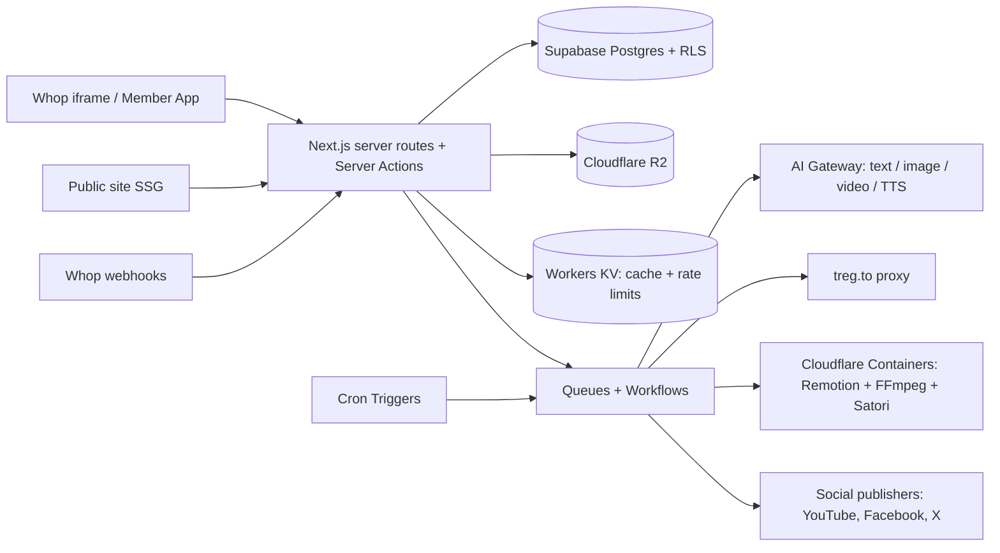

# Backend Documentation

> Faceless Finesse · Draft v1 · 2026-10-18

## 1. Architecture

- **Language/runtime:** TypeScript on Node.js, Next.js App Router route handlers (`/api/*`) and Server Actions, running on **Cloudflare Workers** via `@opennextjs/cloudflare` (see devops.md).
- **Database:** Supabase (Postgres, Row Level Security, Realtime).
- **Storage:** Cloudflare R2 for brand assets and rendered media (signed URLs for private objects).
- **Background jobs:** Cloudflare **Cron Triggers** (every 15 min for autopilot), **Queues** (render/publish fan-out with retries and dead-letter queues) and **Workflows** (multi-step, durable, retryable pipelines for video rendering and publishing).
- **Render worker:** Remotion + FFmpeg (video stitching, captions, voiceover mix) and Satori/Sharp (text-on-image PNGs). Runs in **Cloudflare Containers**, invoked from a Queue consumer, output written to R2; never in the request path. Satori + resvg-wasm can run directly in a Worker for lightweight images.
- **API style:** REST (JSON), versioned under `/api/v1`. Zod-validated inputs/outputs shared with the frontend.

## 2. Authentication & Authorization
- **Login:** Whop. The app runs inside the Whop iframe; each request carries Whop's user token header. The server verifies it with the Whop SDK (`verifyUserToken`) and maps the Whop user ID to an internal `users` row (created on first visit).
- **Access/paywall:** on each session, check the member's access to the experience/product via the Whop API (`checkIfUserHasAccessToExperience`); cache for 5 minutes. Plan tier comes from the Whop membership's product/plan ID.
- **Owner dashboard:** requires Whop admin access to the company (`/dashboard/[companyId]`).
- **Roles:** `member`, `owner_admin`. Agency tier adds `workspace_member` with seats.
- **Database security:** every user-owned table has `owner_id` + RLS `owner_id = auth.uid()`; server uses the service role only inside jobs and webhooks, always filtering by owner explicitly.
- **Public marketing site:** no auth.

## 3. Database Schema (Postgres)
| Table | Key columns | Notes |
|---|---|---|
| `users` | id, whop_user_id (unique), email, name, timezone, created_at | |
| `memberships` | id, user_id, whop_membership_id, plan_id, tier, status, renews_at | Synced from Whop webhooks |
| `workspaces` | id, owner_id, name | One per brand; Agency gets several |
| `onboarding_profiles` | workspace_id, goals, experience, platforms[], hours_per_week | |
| `niches` | id, workspace_id, parent_id (self-ref tree), name, level (niche/sub/micro), monthly_volume, competition, buyer_intent, ease_to_rank_score, trend_score, selected | Micro-niche tree |
| `niche_keywords` | id, niche_id, keyword, volume, cpc, serp_difficulty, fetched_at | From treg.to |
| `offers` | id, workspace_id, problem, audience, format, outline jsonb, price_cents, sales_copy, whop_product_id | |
| `brand_kits` | workspace_id, voice, colors jsonb, fonts jsonb, logo_path | |
| `ideas` | id, workspace_id, niche_id, title, hook, angle, source (ai/viral_link/trend), status | |
| `scripts` | id, idea_id, hook, body, cta, duration_sec, version | |
| `posts` | id, workspace_id, format (video/text/text_image/image), caption, script_id, media_paths[], status (draft/approved/scheduled/published/failed), goal (trust/leads/sales) | |
| `calendar_entries` | id, post_id, scheduled_at, platform | |
| `monetization_plans` | id, workspace_id, steps jsonb, ctas jsonb | |
| `autopilot_settings` | workspace_id, run_time_local, timezone, mode (approve_first/auto_publish), formats[], enabled | |
| `social_accounts` | id, workspace_id, platform, external_id, display_name, access_token_enc, refresh_token_enc, expires_at, scopes | Tokens encrypted |
| `publish_jobs` | id, post_id, social_account_id, status, external_post_id, error, attempts | |
| `render_jobs` | id, post_id, kind, status, output_path, cost_micro | |
| `usage_events` | id, user_id, provider, kind, units, cost_micro, created_at | AI + treg + render cost ledger (server-insert only) |
| `usage_budgets` | user_id, period, limit_micro, used_micro | Per-plan caps, reserved atomically |

**Indexes:** `users.whop_user_id`, `niches(workspace_id, ease_to_rank_score desc)`, `posts(workspace_id, status)`, `calendar_entries(scheduled_at)`, `publish_jobs(status)`, `usage_events(user_id, created_at)`.
**Migrations:** Supabase CLI SQL migrations in `supabase/migrations`, run in CI. **Backups:** Supabase daily backups + point-in-time recovery on the Pro plan.

## 4. API Endpoints (REST, `/api/v1`)
> Full reference with request/response shapes, error format, rate limits and webhooks: **[api.md](api.md)**.

| Method & path | Purpose |
|---|---|
| `GET /me` | Current user, plan, usage |
| `POST /onboarding` | Save quiz answers |
| `POST /niches/discover` · `POST /niches/:id/drill` · `PATCH /niches/:id/select` | Niche & micro-niche finder |
| `POST /offers` · `PATCH /offers/:id` | Offer Builder |
| `POST /ideas/generate` · `POST /scripts/generate` | Ideas & Script Studio |
| `POST/GET/PATCH/DELETE /posts` · `POST /posts/:id/render` · `POST /posts/:id/publish` | Post Studio, rendering, publishing |
| `POST /calendar/generate` · `PATCH /calendar/:entryId` | 30-day calendar |
| `POST /monetization/generate` | Monetization Map |
| `GET/PUT /autopilot` | Autopilot settings |
| `GET /social/:platform/connect` · `GET /social/:platform/callback` · `DELETE /social/:id` | Social OAuth |
| `POST /webhooks/whop` | Whop membership webhooks |
| `GET /admin/members` · `GET /admin/usage` · `PUT /admin/plan-limits` | Owner dashboard |

**Errors** (details in [api.md](api.md) §2): JSON `{ error: { code, message, details } }` with proper HTTP codes (400 validation, 401 unauthenticated, 402 plan limit/budget reached, 403 forbidden, 404, 409 conflict, 429 rate limited, 502 upstream provider failed).
**Rate limiting** (details in [api.md](api.md) §3): per-user limits with Cloudflare Rate Limiting bindings + Workers KV counters (e.g. 30 AI generations/min), plus plan-level monthly budgets in `usage_budgets`.
**Real-time:** Supabase Realtime for render/publish job status updates (no custom WebSockets).

## 5. Third-Party Integrations
| Service | Use | Notes |
|---|---|---|
| **Whop** | Login, access checks, plans, checkout, webhooks | `@whop/sdk`, `@whop/react` |
| **treg.to** | Keyword volume, Google SERP, trends for niche scoring and autopilot | Server-only proxy, `TREG_API_KEY`, per-call and daily cost caps, logged to `usage_events` |
| **AI Gateway (internal module)** | One interface over providers so models can be swapped | Text: Gemini 3.1 Flash-Lite (fallback Groq gpt-oss-120b). Images: FLUX schnell (fal/Cloudflare) + Nano Banana 2.1. Video: Grok Imagine Video 1.5 Lite. Voice: Gemini Flash-Lite TTS. See ai-model-options.md |
| **YouTube Data API v3** | Upload Shorts | Requires Google OAuth verification + API audit for public uploads |
| **Meta Graph API** | Publish to Facebook Pages | Requires Meta app review (`pages_manage_posts`) |
| **X API v2** | Post text/images/video | Paid tiers beyond free limits |
| **Phase 2:** TikTok Content Posting API, Instagram Graph API | After app approvals | |
| **Resend** | Transactional email (draft ready, publish failed) | |
| **Sentry** | Error monitoring | |

## 6. Autopilot Job (daily)
1. A Cron Trigger runs every 15 min and selects workspaces whose `run_time_local` falls in that window.
2. Each selected workspace is enqueued on the `autopilot` Queue; a Workflow runs the steps below. Pull trends: treg.to trends/SERP for the workspace's niche keywords.
3. Pick the best trending angle → generate idea + script (or text/image post per configured formats).
4. Render media (Satori images; Remotion video from scene images + Grok motion clips + TTS).
5. Create `posts` row as `draft` (approve-first) or schedule publish (auto-publish).
6. Notify user. Each step is idempotent, retried with backoff, and charged against the budget before it runs.

## 7. AEO data generation (no drift)
- Public site pages, `sitemap.xml`, `llms.txt`, `llms-full.txt` and JSON-LD are **generated at build time from one source**: a `site-facts.ts` config (name, description, pricing from Whop plan IDs, FAQ entries) plus guide content in MDX.
- `sitemap.xml` `lastmod` comes from each page's content file's last commit date.
- Rebuild on content change (GitHub Actions → `wrangler deploy`); IndexNow ping on publish. Full plan in aeo.md.

## 8. Security
- Social tokens encrypted at rest (AES-256-GCM with a key stored as a Cloudflare secret).
- Webhook signatures verified (Whop). Internal job endpoints are not public; Queues/Workflows are invoked via Worker bindings, and Cron Triggers are internal.
- All inputs Zod-validated; parameterized queries only; generated HTML sanitized.
- Secrets only in env vars: `WHOP_API_KEY`, `NEXT_PUBLIC_WHOP_APP_ID`, `WHOP_WEBHOOK_SECRET`, `TREG_API_KEY`, `GEMINI_API_KEY`, `GROQ_API_KEY`, `FAL_KEY`, `XAI_API_KEY`, `SUPABASE_*`, `TOKEN_ENCRYPTION_KEY`, `YOUTUBE_*`, `META_*`, `X_*`, `RESEND_API_KEY`, `SENTRY_DSN`, `CRON_SECRET` (manual job triggers), `R2_*` / Cloudflare bindings in `wrangler.jsonc`. Set with `wrangler secret put`; documented in `.env.example`.
