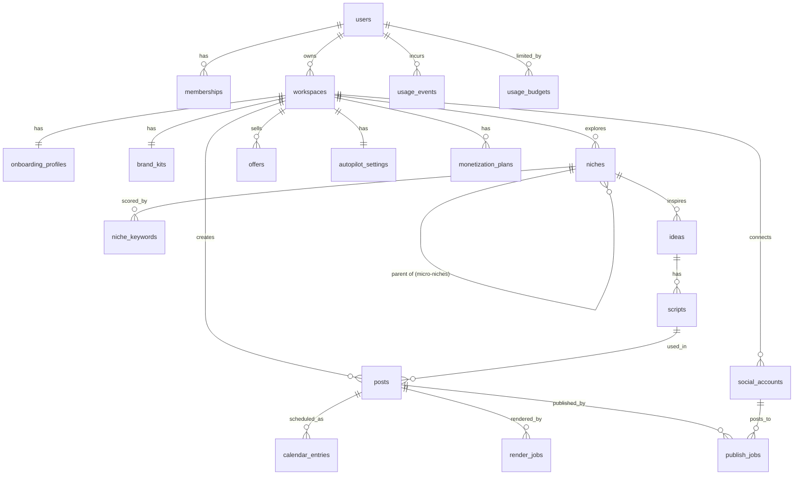

# Database Schema

> Faceless Finesse · Postgres on Supabase · Draft v1 · 2026-10-18

## Tables
(Full column list in backend.md §3.) All user-owned tables carry `owner_id uuid not null` with RLS `using (owner_id = auth.uid())` for select/insert/update/delete; `usage_events` and `usage_budgets` are server-write only.

| Table | Purpose |
|---|---|
| users | Whop-linked user |
| memberships | Whop plan + status (webhook-synced) |
| workspaces | A brand/channel; Agency tier gets multiple |
| onboarding_profiles | Quiz answers |
| niches | Self-referencing tree: niche → sub-niche → micro-niche, with Ease-to-Rank score |
| niche_keywords | treg.to keyword data per niche |
| offers | Digital offer, price, sales copy |
| brand_kits | Voice, colors, fonts, logo (R2 path) |
| ideas / scripts | Faceless ideas and 30s scripts |
| posts | All formats: video, text, text_image, image |
| calendar_entries | Scheduled slots per platform |
| monetization_plans | 5-step plan + CTAs |
| autopilot_settings | Daily time, timezone, mode, formats |
| social_accounts | Encrypted OAuth tokens per platform |
| render_jobs / publish_jobs | Async job tracking |
| usage_events / usage_budgets | Cost ledger and plan budgets |

## Indexes
`users(whop_user_id) unique`, `memberships(whop_membership_id) unique`, `niches(workspace_id, ease_to_rank_score desc)`, `niches(parent_id)`, `niche_keywords(niche_id)`, `posts(workspace_id, status)`, `calendar_entries(scheduled_at)`, `publish_jobs(status, created_at)`, `render_jobs(status)`, `usage_events(user_id, created_at)`, `social_accounts(workspace_id, platform)`.

## Migrations
Supabase CLI SQL migrations in `supabase/migrations`, one per change, applied in CI on merge; RLS policy tests run against a local Supabase in CI.

## Backups
Daily automated backups + point-in-time recovery (Supabase Pro). Quarterly restore drill.
