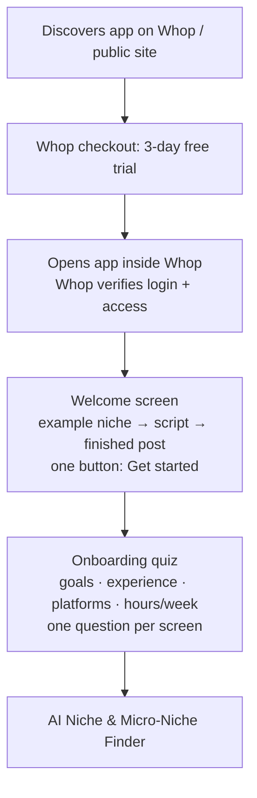
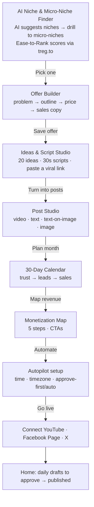
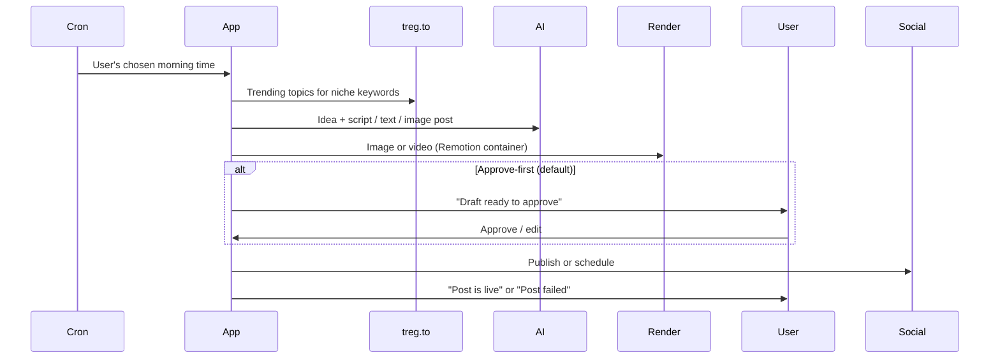

# User Flow Documentation

> Faceless Finesse · Draft v1 · 2026-10-18

## 1. Onboarding Flow

- No separate sign-up or password: Whop handles identity and payment. MFA is whatever the user has on Whop.
- Trial: full features with a reduced AI/treg spending cap. At 24h left → notification. At expiry → paywall screen that opens Whop checkout via the iframe SDK.

## 2. Core User Journey

- No step counter; each screen ends with one primary action leading to the next.
- Every AI output is editable; "Regenerate" and "Undo" on each card.
- Returning users land on **Home** with the single next action (e.g. "3 drafts ready").

## 3. Daily Autopilot Loop

## 4. Error Handling
| Situation | What the user sees | Resolution |
|---|---|---|
| Invalid form input | Inline message under the field | Fix and resubmit |
| Whop access missing/expired | Paywall screen | "Choose a plan" opens Whop checkout |
| AI/treg provider fails | Toast "Couldn't generate, retrying…" | Auto-retry with fallback provider; then "Try again" button |
| Plan limit or budget reached | Banner with usage meter | Upgrade via Whop or wait for reset |
| Publish fails (e.g. expired social login) | Auto-retries; then post turns red on calendar + email | One-click **Reconnect** then **Retry** |
| Render fails | Post marked "Render failed" | Retry button; falls back to image-only post |
| Network loss | Offline banner; edits kept in local draft | Auto-sync on reconnect |

## 5. Edge Cases
- **Offline/flaky network:** drafts persist locally; mutations queue and retry.
- **Incomplete data:** user skipped offer → Monetization Map and CTAs prompt to add one; autopilot still runs with generic CTAs.
- **Expired session in Whop:** silently re-verify token; if it fails, show "Reopen app from Whop".
- **Niche with no data:** treg returns low volume → flagged "Not enough demand", suggest siblings.
- **Timezones/DST:** autopilot time stored with IANA timezone.
- **Platform rate limits:** publish queue spaces posts and respects each API's limits.
- **Trial abuse:** one trial per Whop account; trial spending cap.

## 6. Alternative Flows
- **Skip onboarding quiz:** allowed; defaults are used and editable in Settings.
- **"I already have a niche":** enter it directly and jump to micro-niche scoring.
- **"I already have an offer":** paste a link or details to skip the Offer Builder.
- **Manual mode:** use Studio and Calendar without Autopilot.

## 7. User Permissions
| Role | Can |
|---|---|
| Member (Starter/Pro) | Everything in their own workspace(s), within plan limits |
| Agency seat | Access to shared workspaces the agency owner grants |
| Owner admin (Hector) | Owner dashboard: members, usage/costs, plan limits, alerts |

## 8. Notifications (email via Resend + in-app)
| Trigger | Content |
|---|---|
| Daily draft ready | "Your post for today is ready to approve" + preview + Approve button |
| Post published | "Your post is live on {platform}" + link |
| Post failed | "We couldn't post to {platform}" + reason + Reconnect/Retry |
| Trial ending (24h) | "Your trial ends tomorrow" + what they've built + choose plan |
| Near plan limit (80%) | "You've used 80% of this month's credits" + upgrade |
Users can turn each email off in Settings; in-app alerts always show.
